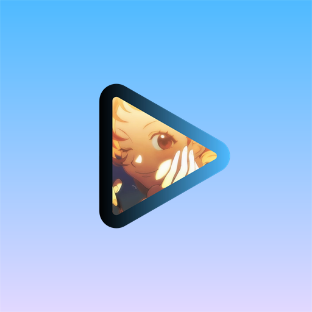

<div align="center">

  

  # BluDreams

  ### *Cinema, uninterrupted. Crafted for pure immersion.*

  **A modern, ad-free streaming experience built for Android phones.**  
  *(with experimental preview for Tablets and Android TV)*

  <p align="center">
    <a href="https://github.com/manozzee/bludreams/releases/latest"></a>
    <a href="https://github.com/recloudstream/cloudstream"></a>
    <a href="LICENSE"></a>
    
  </p>

  <p align="center">
    <a href="https://github.com/manozzee/bludreams/releases/latest"><b>⚡ Download Latest Release</b></a> •
    <a href="#-the-feeling"><b>The Feeling</b></a> •
    <a href="#-signature-cinema-palettes"><b>The Palettes</b></a> •
    <a href="#-get-started"><b>Get Started</b></a> •
    <a href="#️-build"><b>Build</b></a>
  </p>

</div>

---

> [!NOTE]
> ### 🏛️ The CloudStream Heritage
> **BluDreams** is born as an elevated, design-forward fork of [CloudStream](https://github.com/recloudstream/cloudstream)—the open-source foundation known and trusted worldwide.  
> 
> BluDreams preserves seamless compatibility with existing CloudStream extension catalogs while transforming the everyday interaction feel: introducing our floating **Liquid Glass** navigation island, deep neutral charcoal and true AMOLED blacks, 7 hand-curated cinema palettes, tactile rounded search cards, and a direct GitHub release updater. We celebrate and honor the upstream creators and contributors whose architecture made this possible.

---

## ✨ The Feeling

Most streaming apps feel like billboards—cluttered with unskippable ads, noisy sponsored carousels, and algorithms tracking every tap. 

**BluDreams was built to feel different.**  
From the moment you launch the app, everything steps back so the media takes center stage:

- 🌊 **Floating Liquid Glass**: A translucent, frosted acrylic island floats naturally over your backdrops and movie posters, responding with fluid physics and subtle specular reflections.
- 🖤 **True AMOLED & Neutral Dark**: Engineered with pure `#000000` blacks for endless contrast and neutral `#0E0E10` elevation layers—zero annoying blue casts or muddy grays.
- 🚫 **Absolute Peace**: No banners, no commercial interruptions, no analytics tracking, no sign-ups required.
- 🔍 **Intuitive Search & Pill Cards**: Real-time debounced query suggestions designed as clean rounded 16dp capsules that adapt dynamically as you type.
- 📥 **Offline Freedom**: Multi-threaded background downloader with resume support so your movies travel with you anywhere.
- 💬 **Studio-Grade Subtitles**: Crisp typography, adjustable sizing, custom styling, and full support for styled ASS/SSA, SRT, and VTT files.

---

## 🎨 Signature Cinema Palettes

Choose the atmosphere that matches your mood. BluDreams features seven signature colorways crafted specifically for dark-room viewing:

| Atmosphere | Tone | Accent | Variant | Focus Ring | The Experience |
| :---: | :--- | :---: | :---: | :---: | :--- |
| 🔴 | **Velvet Noir** | `#991B1B` | `#450A10` | `#DC2626` | *Deep theatrical crimson; reminiscent of 35mm auditorium velvet and suspense.* |
| 🟡 | **Aura Brass** | `#B98A28` | `#59410D` | `#D9A74A` | *Warm golden brass; glowing vintage cinema and classic amber warmth.* |
| 🟠 | **Smoked Cognac** | `#9A3412` | `#4D1A09` | `#BC4712` | *Warm bourbon amber and embers; rich, earthy, and inviting.* |
| 🟢 | **Obsidian Pine** | `#065F46` | `#022B20` | `#047857` | *Deep twilight forest and emerald mist; calm, grounded, and atmospheric.* |
| 🔵 | **Fincher Teal** | `#0E7490` | `#062E2C` | `#0D7972` | *The sharp clinical cyan of modern psychological thrillers; cold and precise.* |
| 🌌 | **Midnight Lapis** | `#1E40AF` | `#0E1E5B` | `#3B82F6` | *Royal electric blue and neon city lights; vibrant and deep.* |
| 🟣 | **Nocturne Violet** | `#581C87` | `#2A0844` | `#7022AC` | *Neon amethyst and twilight mysticism; hypnotic and rich.* |

*Prefer system harmony? BluDreams also seamlessly blends with **Dynamic Monet (Material You)** wallpaper colors on Android 12+.*

---

## 📱 Form Factors

BluDreams is crafted first and foremost as a **phone-first handheld experience**. 

- **Android Phones**: The core, fully refined touchscreen experience.
- **Android TV & Tablets *(Experimental Beta)***: We are actively previewing a 10-foot D-pad leanback interface for TV remotes and responsive widescreen tablet layouts. Early adopters can test and provide feedback as these adaptive layouts mature.

---

## 🚀 Get Started

### 1. Download & Install
1. Grab the latest **`app-stable-release.apk`** from [GitHub Releases](https://github.com/manozzee/bludreams/releases/latest).
2. Install the APK on your device *(allow "Install from unknown apps" if prompted)*.

### 2. Plug in Your Extensions
1. Open **BluDreams**.
2. Tap **Settings** > **Extensions**.
3. Add your favorite CloudStream repository link.
4. Pick and install your providers.

### 3. Enjoy the Show
Dim the lights, grab some popcorn, and enjoy streaming the way it should have always been.

---

## 🛠️ Build from Source

```bash
# Clone the repository
git clone https://github.com/manozzee/bludreams.git
cd bludreams

# Build Debug APK
./gradlew :app:assembleStableDebug

# Build Signed Release APK
./gradlew :app:assembleStableRelease
```

Artifact output: `app/build/outputs/apk/stable/release/app-stable-release.apk`

---

## ⚠️ Disclaimer

**BluDreams does not host, bundle, or index any media content or video streams.**  
The application is strictly an open-source media player shell. Users are solely responsible for installing their own extensions and ensuring compliance with local laws and media sources.

---

## 📄 License & Credits

- Licensed under the [GNU General Public License v3.0 (GPL-3.0)](LICENSE).
- Proudly built on the open-source legacy of [CloudStream](https://github.com/recloudstream/cloudstream).
